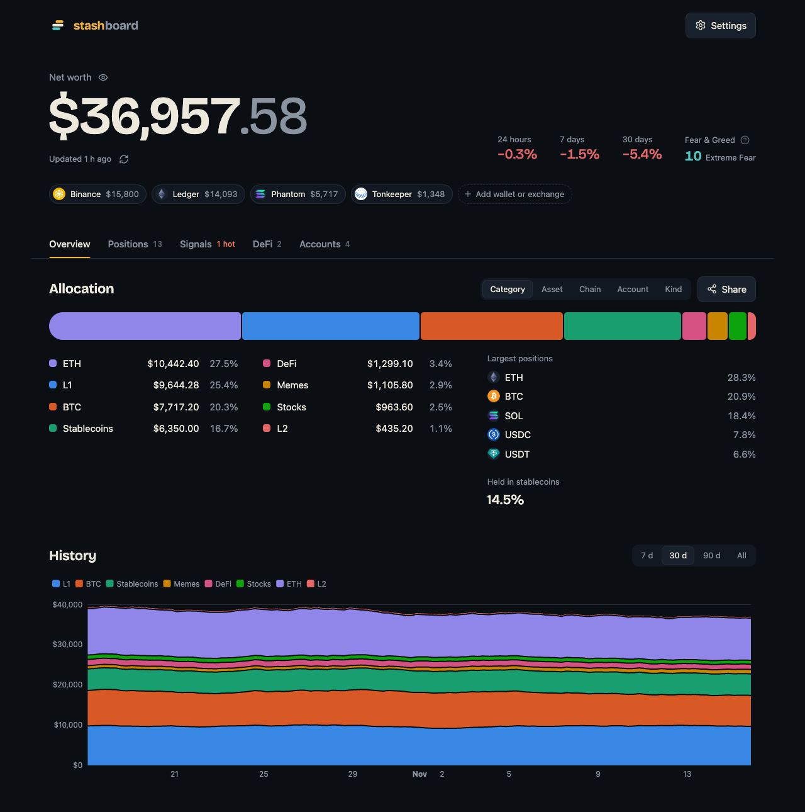
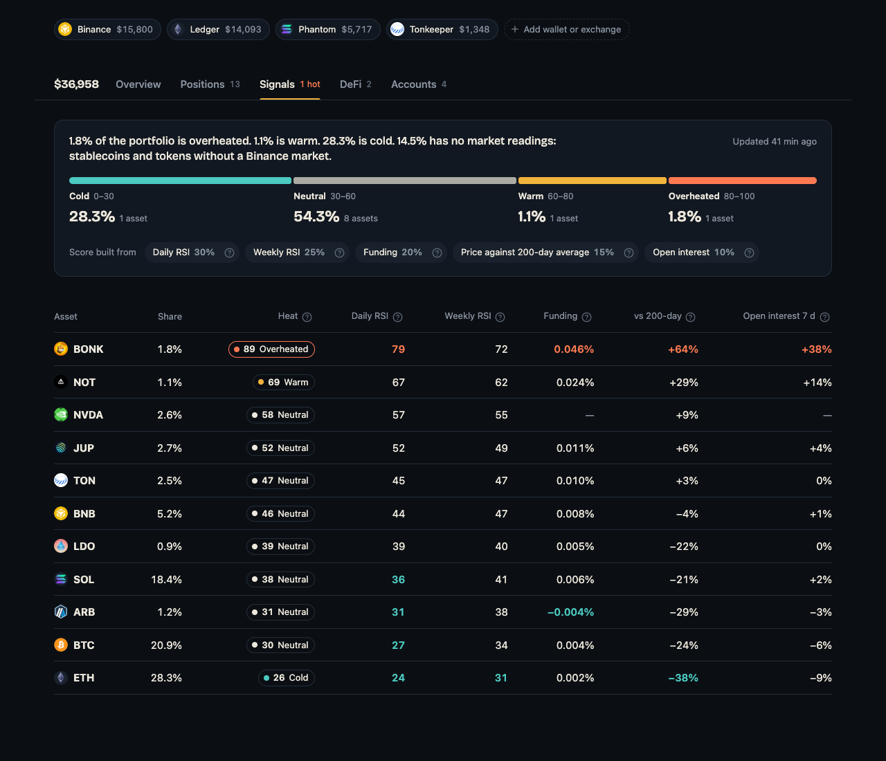
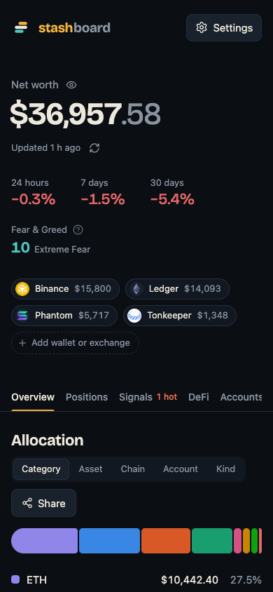

<p></p>

**Your whole stash on one board.** A self-hosted, read-only portfolio dashboard for people whose crypto is
spread across exchanges, several chains and a handful of DeFi protocols.



Stashboard reads your balances from Binance, Bybit, OKX, EVM chains, Solana and TON, merges them into one portfolio,
shows how it is allocated, keeps its history, and scores every position from cold to overheated. It runs on
your own server, needs only free API keys, and never asks for anything that can move your money.

## What it does

- **One net worth** across Binance, Bybit and OKX, wallets on any EVM chain, Solana and TON, positions in DeFi
  protocols, and perpetuals on Lighter.
- **Allocation** by category, asset, chain, account or kind, with every place an asset is held.
- **History** of the whole portfolio, and changes over 24 hours, 7 and 30 days.
- **Heat signals**: RSI, funding, distance from the 200-day average and open interest blended into one score
  per asset, with each reading explained and sourced.
- **Privacy**: hide every amount on every device in one click, and share an allocation picture or a
  time-limited link without amounts.
- **Read-only by design**: wallets need a public address, exchanges a key that can only read, which is
  checked before it is saved and stored encrypted.

## Principles

- **Read-only.** No seed phrases, no signatures, no trading or withdrawal permissions.
- **Yours.** One SQLite file on your own server. No analytics, no third-party trackers, no account with us.
- **Free.** Every data source works on a free tier.
- **Small.** One app container behind Caddy, one database file, a frontend with no build step.

## Try it in a minute

The demo runs with made-up data and calls no balance API. It needs [Node.js 24](https://nodejs.org) or newer.

```sh
git clone https://github.com/sakomg/stashboard.git
cd stashboard
npm ci
npm run demo
```

Open http://127.0.0.1:8787.

## Install on your server

You need a small Linux server with [Docker](https://docs.docker.com/engine/install/), and a host name pointing
at it (a free [DuckDNS](https://www.duckdns.org) subdomain works).

```sh
git clone https://github.com/sakomg/stashboard.git
cd stashboard
./install.sh
```

The installer asks for the host name and the free API keys, starts Stashboard behind Caddy with automatic
HTTPS, and prints a setup code. Open `https://your-host/setup`, enter the code, choose a password and scan
the authenticator QR code. Then add your wallets and exchanges on the page.

To update later: `git pull && ./install.sh`.

The full guide, with DNS, firewall, API keys, backups, moving servers and troubleshooting, is in
[docs/self-hosting.md](docs/self-hosting.md).

## Run it on your own computer

With Node.js 24:

```sh
npm ci
cp config.example.json config.json
npm start
```

The dashboard is at http://127.0.0.1:8787 and, without an account, listens on this machine only. Add your API
keys to `config.json` first; [docs/self-hosting.md](docs/self-hosting.md#api-keys) says where to get them.

## Screenshots

| Signals                                                                                                                         | Phone                                                     |
| ------------------------------------------------------------------------------------------------------------------------------- | --------------------------------------------------------- |
|  |  |

All screenshots use the demo data.

## Data sources

| What                                                    | Source             | Key                     |
| ------------------------------------------------------- | ------------------ | ----------------------- |
| Binance: Spot, Funding, Earn, Futures, tokenized stocks | Binance API        | Read-only key, per user |
| Bybit: Unified Trading, Funding, Earn                   | Bybit API          | Read-only key, per user |
| OKX: Trading, Funding, Simple and on-chain Earn         | OKX API            | Read-only key, per user |
| EVM chains: tokens and DeFi positions                   | Zerion API         | Free key                |
| Solana: tokens, staking, tokenized stocks               | Zerion API         | Free key                |
| Lighter and Lighter on Robinhood Chain                  | Lighter public API | None                    |
| TON: TON and jettons                                    | TonAPI             | Free key, optional      |
| Fallback prices, logos and categories                   | CoinGecko          | Free demo key, optional |
| RSI, funding, open interest                             | Binance public API | None                    |
| Fear & Greed                                            | alternative.me     | None                    |

## Documentation

- [Self-hosting](docs/self-hosting.md): install, configure, update, back up, move and troubleshoot.
- [User guide](docs/guide.md): the views, the heat score, categories, privacy, sharing and history.
- [Architecture](docs/ARCHITECTURE.md): how it works and why it is built that way.
- [Security](SECURITY.md): the security model, and how to report a vulnerability.
- [Contributing](CONTRIBUTING.md): development setup and conventions.
- [Changelog](CHANGELOG.md).

## Roadmap

- A desktop app built from the same code, for people who prefer to keep everything on their computer.
- More exchanges, through read-only API keys, beyond Binance, Bybit and OKX.
- More chains through free sources.

Ideas and bug reports are welcome in the issues.

## License

[MIT](LICENSE). Stashboard uses [Lucide](https://lucide.dev) icons (ISC), [Apache ECharts](https://echarts.apache.org)
(Apache 2.0), [Bricolage Grotesque](https://github.com/ateliertriay/bricolage) (SIL Open Font License) and
[Fastify](https://fastify.dev) (MIT). Market data comes from the providers listed above under their own terms.

The mark is three stacked bars: a stash, a bar chart, and the heat scale the product is built around. Teal
is cold, bone is neutral, amber is hot.
